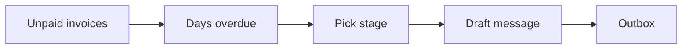

# Payment Reminder Bot

> Polite on day 1, firm on day 14, escalated on day 30, without anyone remembering to chase.

     

**Sector:** Finance & Collections  ·  **Project 6 of 50** in my [AI Automation Projects series](https://github.com/Princewill106/Princewill106)

## The problem

Small businesses lose cash flow to invoices nobody chased. Chasing is awkward, so it gets put off, and when it finally happens the tone is wrong: too soft for a 45-day debt or too harsh for a client who simply forgot.

## How it works



1. **Load** — Read open invoices from `sample_invoices.csv` (client, amount, due date, channel).
2. **Age** — Compute days overdue against today's date.
3. **Stage** — Map days overdue to a stage from `stages.json` (due soon, friendly, firm, final, escalate).
4. **Draft** — Fill the stage template, or have an LLM personalise it when a key is set.
5. **Queue** — Write an outbox file per channel so a WhatsApp/email sender (or n8n) can send them.

## Features

- Configurable reminder stages
- WhatsApp and email outboxes
- Escalation list for account managers
- Never messages paid or disputed invoices
- Optional LLM tone personalisation

## Quick start

```bash
git clone https://github.com/Princewill106/payment-reminder-bot.git
cd payment-reminder-bot
python main.py --demo
```

No installs needed: it uses only the Python standard library. The demo runs fully offline using the sample data in this repo.

**Optional: plug in an LLM.** Copy `.env.example` to `.env` and add an Anthropic or OpenAI key. The project will then use the model for the language-heavy steps and fall back to its rule-based logic if a call fails.

Run the tests:

```bash
python -m unittest -v
```

## Sample output

```text
[WHATSAPP] INV-201 due soon  (-1 days) -> +2348030000001
           Hi Bright Schools, a quick heads-up that invoice INV-201 for NGN 350,000 is due on 2026-10-10. Thank you!

[WHATSAPP] INV-170 firm      (+15 days) -> +2348030000002
           Dear Zenith Clinics, invoice INV-170 for NGN 780,000 is now 15 days overdue. Please arrange payment this week or let us know when to expect it.

[WHATSAPP] INV-120 escalate  (+69 days) -> +2348030000003
           Dear Mainland Pharmacy, invoice INV-120 (NGN 410,000) is 69 days overdue and has been passed to our accounts manager, who will contact you.

[EMAIL   ] INV-188 friendly  (+5 days) -> kola@example.com
           Hi Kola Foods, just a reminder that invoice INV-188 (NGN 120,000) was due on 2026-10-04. If it's already sent, please ignore this. Thanks!

[EMAIL   ] INV-150 final     (+34 days) -> ops@example.com
           Dear Harbour Traders, this is a final reminder: invoice INV-150 (NGN 95,000) is 34 days overdue. Please settle within 5 working days to avoid service suspension.

Escalate to account manager: ['INV-150', 'INV-120']
Skipped: [('INV-160', 'paid'), ('INV-165', 'disputed'), ('INV-210', 'not due yet')]
```

## Use it in n8n (no code needed)

[`n8n-workflow.json`](n8n-workflow.json) is a ready-to-import n8n version of this project, built for n8n 1.x.

1. In n8n, open **Workflows → Import from File** and choose `n8n-workflow.json`.
2. Click **Test workflow**. It runs the full logic on the sample data built into the *Sample data* node, so you can see the results before connecting anything.
3. Open each output node and connect your accounts: Gmail (OAuth2), Google Sheets (OAuth2), WhatsApp Business Cloud API. For Google Sheets, pick your spreadsheet and sheet.
4. Adjust the settings at the top of the **Logic** node (thresholds, templates, contacts), then **Activate**.

**Flow:** **Schedule (weekdays 9am)** → Read open invoices → **Logic** (Code node) → **Route** (Switch)

**Outputs:**
- Send WhatsApp reminder
- Send email reminder

The Logic node is a JavaScript port of the rules in `main.py`, so you can run the project in n8n without Python.

## Use it on your own data

Export open invoices as CSV (`invoice,client,contact,channel,amount,due_date,status`), edit `stages.json`, then run `python main.py --today 2026-10-09`. Connect `output/outbox_*.json` to your sender of choice.

## Project structure

```text
n8n-workflow.json            Importable n8n workflow
.env.example                 Optional API key settings
.gitignore                   Git ignore rules
LICENSE                      MIT license
README.md                    This file
llm.py                       Optional LLM helper (offline fallback)
main.py                      Entry point and core logic
requirements.txt             Dependencies (stdlib only)
sample_invoices.csv          Sample input data for the demo
stages.json                  Reference / config data
test_main.py                 Unit tests
```

## Who this is for

- Agencies and consultants with monthly retainers
- Schools collecting fees
- Distributors with credit customers

## Ideas to extend it

- [ ] Send directly via WhatsApp Business API and SMTP
- [ ] Paystack/Flutterwave payment links in each message
- [ ] Stop reminders automatically when payment lands
- [ ] Weekly ageing report

## About

Built by **Ogbu Ugochukwu Princewill**, AI Automation Lead and robotics engineer. I teach people and businesses to build with AI, not just talk about it. [LinkedIn](https://www.linkedin.com/in/ugochukwu-ogbu-653a0816a)

If this helped you, give it a ⭐ and share what you built with it.

## License

MIT — see [LICENSE](LICENSE).
